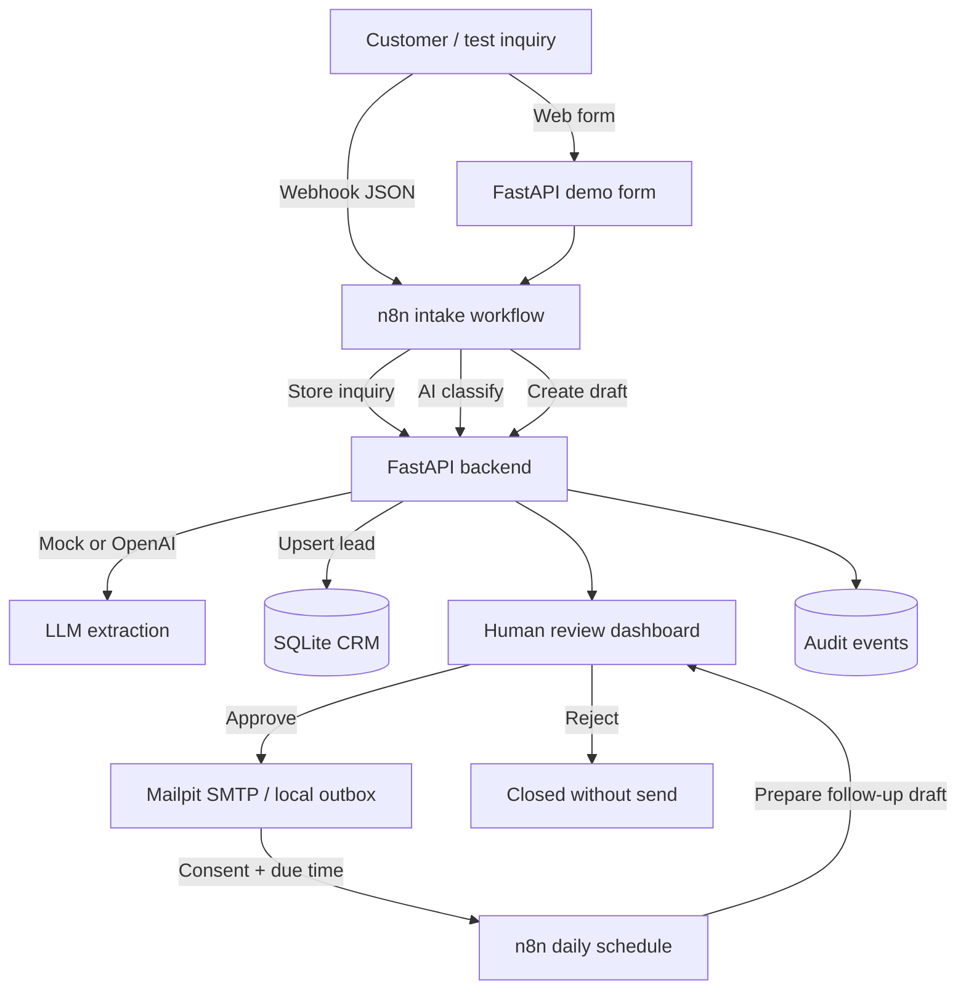

# AI Email & CRM Automation · n8n + FastAPI

**A local human-in-the-loop automation demo with a reviewer dashboard and CRM lead triage.**

Turn a web form or webhook inquiry into an **AI-classified lead**, an **internal CRM record**, and an **editable reply awaiting human approval**. After approval, optionally prepare a scheduled follow-up draft. Designed as a practice project for backend integration and customer-service automation.

**Tech:** n8n · Python/FastAPI · SQLite/SQLAlchemy · OpenAI API (optional) · Docker Compose · Mailpit · Pytest

> [!IMPORTANT]
> **Safe by default:** AI runs in deterministic `mock` mode without an API key; **sending always requires a human click**. Docker emails go only to a local Mailpit inbox. This is a portfolio demo, **not a production-ready customer messaging platform**.

## What it does

- Accepts customer inquiries through the demo form or an n8n webhook (`source: webform` or `source: email`).
- Classifies inquiries by **intent** (`pricing`, `appointment`, `support`, `general`) and **priority**.
- Extracts a concise summary and requirements. Set `AI_MODE=openai` for real LLM-powered extraction.
- Creates/updates a **local CRM lead** by email (SQLite); no external CRM credentials required.
- Creates an **intent-specific reply draft** (pricing, scheduling, support, or general), which a reviewer can edit, approve, or reject.
- Displays **urgent inquiries first** in the approval inbox; a reviewer can manually mark CRM leads as new, qualified, contacted, or archived.
- Sends approved emails to **Mailpit (local inbox)** in Docker; when run without SMTP, stores them in a local outbox.
- Schedules follow-up **drafts only with opt-in** and requires a second approval before sending.
- Keeps a basic audit trail, including manual lead status changes; includes validation, full-payload idempotency checks, tests, and GitHub Actions CI.

## Architecture



The included n8n workflows orchestrate intake/classification/draft creation and the daily follow-up-draft sweep. **Approval is deliberately a separate authenticated FastAPI UI**, so no n8n credentials are required for that step.

## Quick start (Docker Desktop)

**Prerequisite:** Docker Desktop with Compose. No OpenAI key needed for the first run.

```bash
# 1) Clone or unzip this repository
cd ai-inquiry-crm-automation

# 2) Create a private configuration file
cp .env.example .env
# Edit .env: replace INTERNAL_API_TOKEN and ADMIN_PASSWORD with strong values

# 3) Start the application, n8n, and a safe email inbox
docker compose up -d --build
```

| Local URL | Purpose |
|---|---|
| http://localhost:8000 | Sample customer inquiry form |
| http://localhost:8000/admin | Protected human approval / CRM dashboard |
| http://localhost:8000/docs | Interactive API docs |
| http://localhost:5678 | n8n workflow editor |
| http://localhost:8025 | Mailpit – inspect approved emails |

**First-run n8n setup (required):**

1. Open `http://localhost:5678` and complete the local n8n owner-account setup.
2. Import **both** JSON files using **Import from File** in the n8n editor:
   - `n8n/workflows/01-intake-and-review.json`
   - `n8n/workflows/02-scheduled-followups.json`
3. **Activate / publish** each workflow in n8n. Saved workflows that aren't active don't register the production webhook.
4. Verify the `customer-inquiry` webhook is registered and that n8n can access `api:8000` within Docker.
5. Open `http://localhost:8000`, complete the form, and submit it.
6. Open `http://localhost:8000/admin`; sign in using `ADMIN_USERNAME` / `ADMIN_PASSWORD` from `.env`.
7. Read or edit the draft, enter a reviewer name and click **Approve & send**.
8. Open `http://localhost:8025` to see the delivered *demo* message.

### Send a sample with cURL

After the intake workflow is activated:

```bash
curl -sS -X POST http://localhost:5678/webhook/customer-inquiry \
  -H 'Content-Type: application/json' \
  --data-binary @examples/sample_inquiry.json
```

You should receive an object containing an `inquiry_id`, a `draft_id`, and status `pending`. Then review it in `/admin`.

> If n8n returns a webhook-not-registered error, activate/publish the imported workflow. `webhook-test` URLs are different from the active `/webhook/` URL.

### Try a follow-up immediately

By default follow-up drafts become eligible **48 hours after an approved initial reply** and only if the customer explicitly opted in. To show the feature in a demo:

1. Change `FOLLOWUP_DELAY_HOURS=0` in `.env`; restart API with `docker compose up -d --force-recreate api`.
2. Submit a **new inquiry** with the checkbox enabled, then approve the first reply.
3. Click **Prepare due follow-ups** at `/admin`, or wait for the daily n8n schedule.
4. Review and approve the follow-up draft. It is **never automatically sent**.

## AI modes

### Demo mode – zero setup

`AI_MODE=mock` uses deterministic keyword classification and a summary built from the inquiry text. **It does not call an LLM**, despite demonstrating the full workflow. This keeps demos free, reliable and private.

### Real OpenAI extraction

Set these values in `.env`:

```dotenv
AI_MODE=openai
OPENAI_API_KEY=your-secret-key
OPENAI_MODEL=gpt-4o-mini
```

Then run `docker compose up -d --force-recreate api`. The Python backend calls the Chat Completions API for structured extraction. Reply drafts are intentionally conservative templates that a reviewer can edit. Errors are surfaced to the workflow instead of silently pretending AI succeeded.

**Privacy:** Real LLM mode transfers inquiry text to an external AI provider. Get suitable customer consent and apply appropriate privacy/retention policies before using actual client data.

## Run Python tests locally (without Docker or n8n)

```bash
python -m venv .venv
source .venv/bin/activate           # Windows PowerShell: .venv\Scripts\Activate.ps1
pip install -r requirements-dev.txt
python -m pytest -q
python scripts/validate_workflows.py
```

These tests cover authentication, validation, CRM upserts, full-payload idempotency, intent-aware drafts, priority sorting, manual lead qualification, human approval, rejection, follow-up consent, audit logs and HTML escaping. They use a temporary in-memory SQLite database and no external network. Note that **the live n8n import / Docker integration has not been validated by this test suite**.

### Run API alone, without Docker

```bash
cp .env.example .env
mkdir -p data
python -m uvicorn app.main:app --reload
```

You can call the documented internal API endpoints (`/docs`) using your `INTERNAL_API_TOKEN` and inspect approved messages in `/admin/outbox` because SMTP is unset. The **web demo form** forwards to n8n, so it needs a running n8n instance; for an API-only demonstration, call the three endpoints directly with the token.

## API overview

| Method | Endpoint | Purpose | Auth |
|---|---|---|---|
| GET | `/api/health` | Liveness | none |
| POST | `/api/inquiries` | Store a validated inquiry | `X-Internal-Token` |
| POST | `/api/inquiries/{id}/process` | Classify and upsert CRM lead | `X-Internal-Token` |
| POST | `/api/inquiries/{id}/draft` | Create editable initial draft | `X-Internal-Token` |
| GET | `/api/inquiries/{id}` | Check status / summary | `X-Internal-Token` |
| POST | `/api/followups/prepare` | Prepare due, opted-in follow-up drafts | `X-Internal-Token` |
| GET | `/admin` | Review, priority queue, CRM, audit trail | HTTP Basic |
| POST | `/admin/leads/{id}/status` | Manual lead qualification / archiving | HTTP Basic |
| POST | `/admin/drafts/{id}/approve` | Human review + send | HTTP Basic |
| POST | `/admin/drafts/{id}/reject` | Reject without sending | HTTP Basic |
| GET | `/admin/outbox` | Show safe local outbox (without SMTP) | HTTP Basic |

Detailed implementation and tradeoffs: [docs/architecture.md](docs/architecture.md). A map of code changes: [docs/implementation-notes.md](docs/implementation-notes.md).

## Publish on GitHub

1. **Do not include `.env`**, database files, n8n credentials or real customer messages. These are ignored by `.gitignore`.
2. Create an **empty public repository** on GitHub called `ai-inquiry-crm-automation`. Leave “Add README” unchecked because this project already contains one.
3. From the project directory:

```bash
git init
git add .
git commit -m "Build n8n AI inquiry and CRM automation demo"
git branch -M main
git remote add origin https://github.com/akramswe/ai-inquiry-crm-automation.git
git push -u origin main
```

The example remote uses `akramswe`; replace it if you plan to publish from another GitHub account. Authenticate using your normal GitHub sign-in flow. You can also create an empty repository in the GitHub website and upload the extracted project files manually.

**Portfolio tip:** Record a 60–90-second screen capture showing (1) the form, (2) n8n execution, (3) the CRM lead and review draft, and (4) the email in Mailpit. Add the screenshots to a new `docs/screenshots/` folder and embed them in this README. Don't claim you measured time savings unless you have real measurements.

## Honest boundaries / production hardening

This is a **working backend demonstration with importable n8n workflow exports**. It is not certified or tested as production software. Before real client use, implement proper session login + CSRF protection, TLS, production-grade database migrations and backups, queue/retry/outbox delivery, concurrency controls, CRM connector OAuth, real inbox triggers (Gmail/IMAP), data protection and retention, metrics, error monitoring and rate limiting. A crash after SMTP accepts a message but before the DB transaction commits can cause a duplicate on retry.

**Email integration note:** In this repository, email inquiries are **represented as webhook payloads** using `"source": "email"`. Connecting a *real inbox* requires creating a Gmail/IMAP trigger and providing your own credentials in n8n. This is intentional: real mailbox credentials are never shipped in a public GitHub repository.

Stop everything with `docker compose down`; add `-v` to also delete the demo's Docker database and n8n data (irreversible).

## License

MIT — see [LICENSE](LICENSE).

## Presenting this to an employer

See [docs/portfolio-presentation.md](docs/portfolio-presentation.md) for a one-minute project explanation, live-demo checklist, accurate CV bullets, and engineering trade-offs to discuss in interviews.
