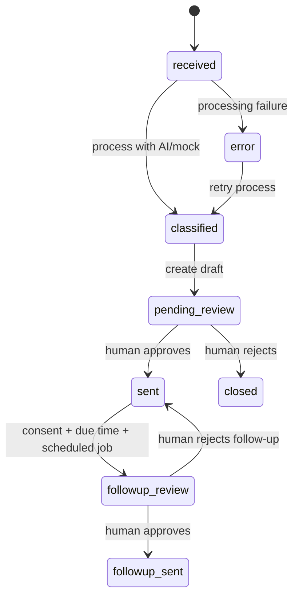

# Architecture notes and engineering trade-offs

## Service boundaries

- **n8n** owns orchestration, webhook entry, and a timed follow-up sweep. Workflow exports are in `n8n/workflows/`. It calls the API over Docker's internal service hostname `api`.
- **FastAPI** owns validation, durable inquiry state, extraction, local CRM, business rules and the review UI.
- **SQLite** stores inquiries, leads, reply drafts, audit events and (when SMTP is disabled) local outbox messages. The lightweight CRM is a demo replacement for HubSpot/Salesforce.
- **Mailpit** captures locally sent SMTP messages; it isn't a production email provider.

## State transitions

Every approved message comes from a stored, reviewed draft. A follow-up is not sent without opt-in and a second approval.

## Idempotency and failure handling

- `idempotency_key` is optional on inquiry creation; retries with the same key and message return the original record. A reused key with different email/message yields HTTP 409.
- `POST /api/inquiries/{id}/process` skips already processed/sent/closed inquiries. It records `error` status and an audit event if extraction fails; the n8n HTTP node receives an error.
- Draft creation is idempotent via unique (`inquiry_id`, `kind`).
- Approval refuses drafts that aren't `pending`.
- A rejected *initial* draft closes its inquiry. Follow-up rejection stops that specific follow-up.
- Approved SMTP delivery is attempted synchronously before DB commit. That's suitable for a portfolio demo but can create duplicate delivery if the process crashes between SMTP acceptance and DB commit. Production systems need a transactional outbox, unique delivery IDs and retries.

## LLM behavior

- Mock mode: deterministic keyword matching + normalized summary. It's explicit in the UI/docs that this is a *simulation*, not a model inference.
- OpenAI mode: JSON-only classification request, validated through Pydantic. No private credentials are embedded in workflow JSON; the prompt treats customer input as untrusted.
- The reply template deliberately avoids inventing prices, availability or commitments. The reviewer can edit it.

## Security and data protection

- Docker ports are mapped to **127.0.0.1**, so this stack is for a developer's laptop.
- Backend API requires `X-Internal-Token`; the browser-facing form forwards through the n8n webhook.
- Reviewer dashboard uses HTTP Basic **only as a local demo convenience**. Cross-site origins are blocked for admin form submissions, but this is not a replacement for hardened authentication and CSRF protection.
- Enabling `$env.INTERNAL_API_TOKEN` in n8n expressions requires `N8N_BLOCK_ENV_ACCESS_IN_NODE=false` for the local demonstration. Restrict workflow editor access, and prefer dedicated n8n credentials for production.
- Never commit `.env`, the database, workflow execution logs with customer data, or exported n8n credential bundles.
- In OpenAI mode, messages leave the container and are processed by the configured third-party provider.
- No production retention, anonymization, observability, GDPR handling, or rate limiting is implemented. Add those before real-world use.

## Suggested extensions

1. Add an n8n Gmail/IMAP trigger with OAuth, mapping genuine message sender, subject and body to the webhook contract.
2. Add an authenticated HubSpot or Pipedrive API adapter (with retry and event deduplication) in place of or alongside the demo CRM.
3. Add an actual AI agent with controlled tool permissions for reading structured product information and producing fact-grounded draft proposals.
4. Migrate from SQLite to Postgres, add Alembic migrations, Redis or a task queue, and transactional outbox delivery.
5. Add error workflows and alarms in n8n, infrastructure monitoring and CI integration tests in Docker.
